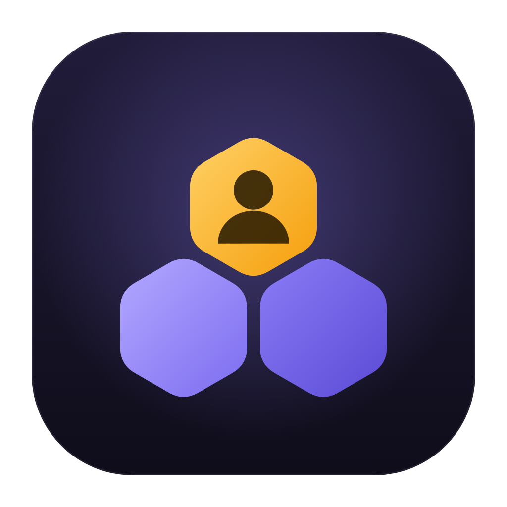
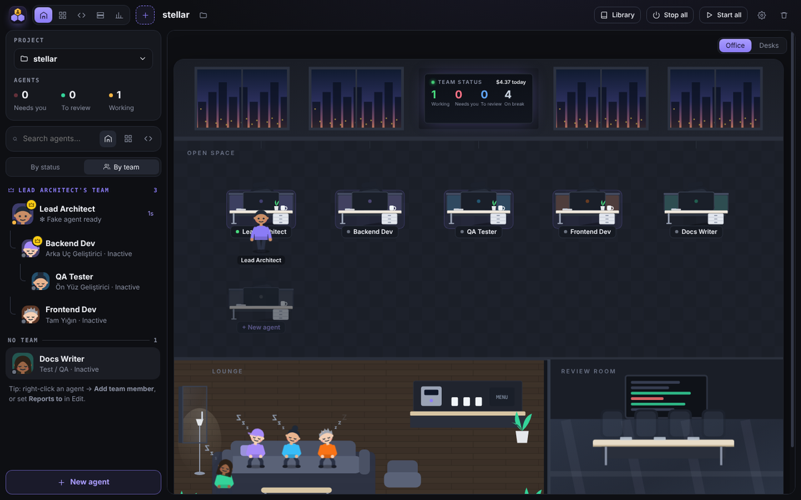
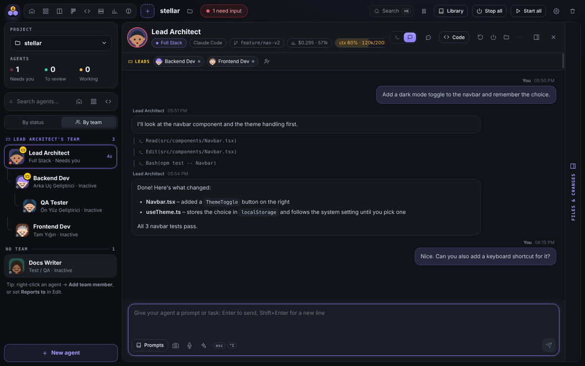
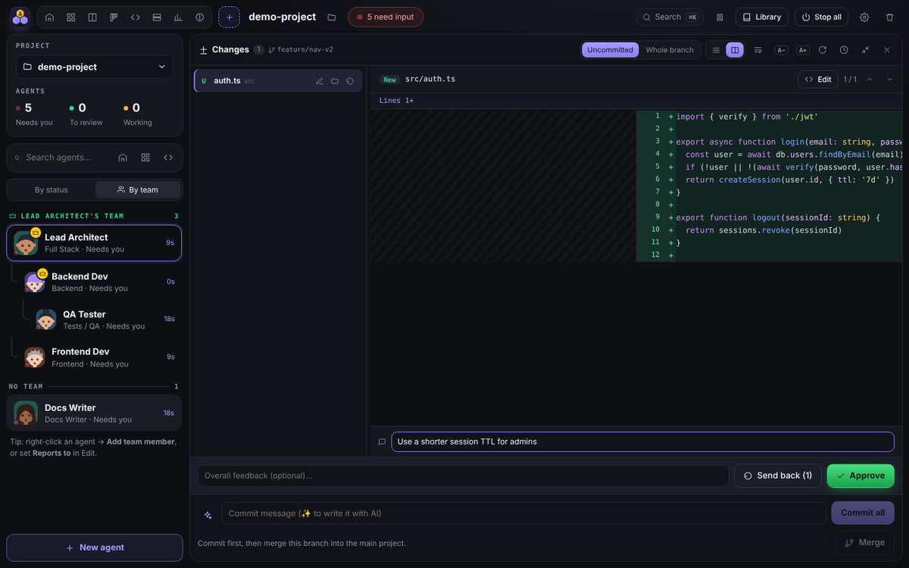
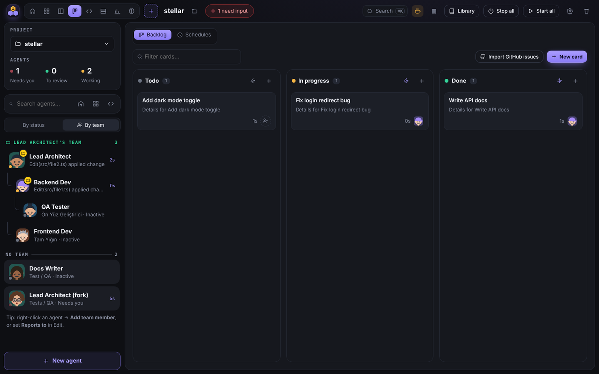
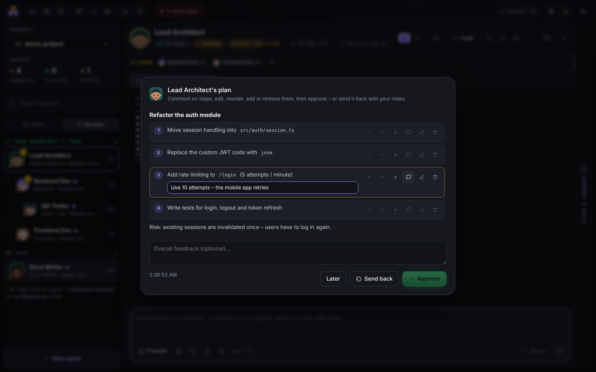
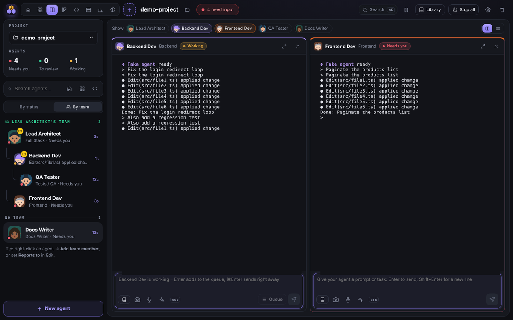
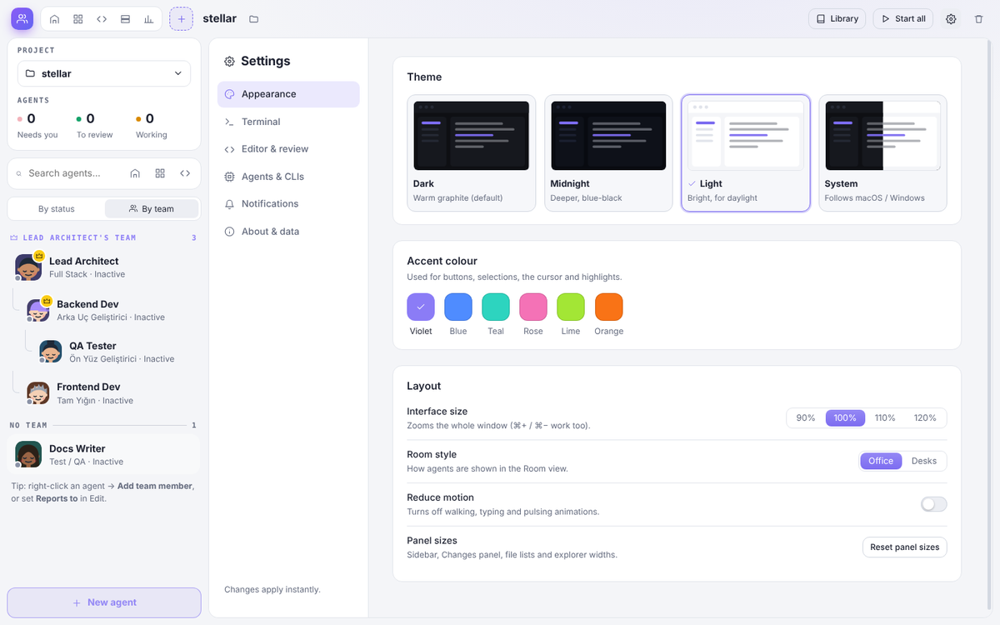

<div align="center">



# Hive

**A desktop command center for AI coding agents.**
Run Claude Code, Codex, Gemini or any CLI agent side by side – each in its own real terminal and git worktree –
and watch them work together in a little office.

macOS · Windows · Linux &nbsp;·&nbsp; Electron + React + TypeScript &nbsp;·&nbsp; MIT



</div>

---

## Why Hive?

Running several coding agents at once quickly turns into a mess of terminal tabs. Hive gives every agent a seat:
you see at a glance who is **working**, who **needs you**, and what each one changed – then review, commit and merge
without leaving the app. Hive runs the official CLIs you already use, locally. There is no proxy, no cloud relay and no
extra account: your Claude / OpenAI subscription or API key stays with the CLI.

## Highlights

| | |
|---|---|
| 🏢 **Office view** | Agents sit at desks, type while working, raise a hand when they need you and walk to the review room when done. |
| 🌳 **Git worktree per agent** | Every agent gets its own branch & folder, so nobody overwrites anybody. Review, commit (✨ AI message) and merge in one place. |
| 👥 **Teams** | A lead agent hands out tasks to its team over MCP (`send_task`, `wait_for_agents`, `report_to_lead`…). |
| 🗂 **Backlog, schedules, workflows** | Kanban cards that hand work to agents, recurring prompts, and pipelines like *PM plans → Dev builds → QA tests*. |
| 🧪 **Guard rails** | Plan review, a test guard that sends failures back, daily budget with auto-pause, overlap warnings between branches. |
| 💬 **See inside the session** | Conversation view, live context-window meter, side questions that don't interrupt, fork a conversation. |
| ⌨️ **Built-in IDE** | Monaco editor with IntelliSense, JetBrains or VS Code keymap, auto save, markdown preview, "Open in IDE". |
| 🖥 **Dev servers + preview** | Detected from `package.json`, `.csproj`, Django, Compose – with a live preview at desktop / tablet / mobile width. |

<table>
<tr>
<td><br><sub><b>Conversation view</b> – a Claude Code session as a chat, with context meter</sub></td>
<td><br><sub><b>Vibe review</b> – notes per file, send back or approve (commit + merge)</sub></td>
</tr>
<tr>
<td><br><sub><b>Backlog</b> – cards hand work to agents as they move</sub></td>
<td><br><sub><b>Plan review</b> – comment, edit or remove steps before any code is written</sub></td>
</tr>
<tr>
<td><br><sub><b>Split view</b> – several agents side by side, each with a message queue</sub></td>
<td><br><sub><b>Settings</b> – Dark / Midnight / Light / System themes and accent colours</sub></td>
</tr>
</table>

## Download

Grab the latest installer from **[Releases](https://github.com/burakilk/hive/releases/latest)** –
`.dmg` for macOS (Apple Silicon / Intel), `-setup.exe` for Windows, `.AppImage` for Linux.

> **macOS:** Hive isn't notarized yet – after moving it to Applications run `xattr -cr /Applications/Hive.app` once
> (or right-click → *Open*).

## Build from source


**Requirements:** Node 20+, git, and at least one agent CLI on your `PATH` (`claude`, `codex`, `gemini`, `aider`…).
The terminal module (`node-pty`) is compiled for Electron, so you also need a C++ toolchain:

- **macOS:** `xcode-select --install`
- **Windows:** Visual Studio Build Tools with *Desktop development with C++*

```bash
git clone https://github.com/burakilk/hive.git
cd hive
npm install          # also compiles node-pty for Electron

npm run dev          # run in development mode (hot reload)
npm run app          # macOS: build Hive.app and install it to /Applications
```

Log in to your CLIs once in a normal terminal (`claude`, `codex login`, …) – Hive uses their existing sessions.
Then open Hive, **Add a project folder**, and create your first agent (⌘N).

<details>
<summary>Other build targets</summary>

```bash
npm run dist:mac     # .dmg in dist/
npm run dist:win     # Windows installer
npm run dist:linux   # AppImage
npm run typecheck    # TypeScript check for main + renderer
```

The app is not signed with an Apple developer certificate. `npm run app` signs it ad-hoc and clears the quarantine flag;
for a downloaded build use right-click → *Open* or `xattr -cr /Applications/Hive.app`.
</details>

## Features

### Agents & projects
- **Projects** are folders on your disk; create as many agents per project as you like (name, role, colour, CLI, first task).
- **Supported CLIs:** Claude Code, Codex CLI, Gemini CLI, plain shell – add any other CLI in *Settings → Agents & CLIs* (with a PATH check).
- **Git worktree isolation:** each agent works in `../.hive-worktrees/<project>/<agent>` on branch `hive/<agent>`.
- **Precise status for Claude Code** via hooks (working / needs you / done); other CLIs use output-silence detection.
- **Resume** the last conversation, **restart**, **interrupt**, **duplicate**, **pause after this turn** – from the right-click menu anywhere.
- **Teams:** set *Reports to*; Claude leads get MCP tools to delegate, wait for and read reports from their team.
- **Fork** a Claude conversation into a new agent (own branch), **change role** mid-session (PM → Dev → QA) or **ask a side question** to a read-only copy without interrupting.
- **Prompt & role library** with placeholders (`{{agent}}`, `{{branch}}`…); roles become Claude's appended system prompt.

### Working with agents
- **Message box** with prompt library, screenshots (**⌘⇧2**, paste or drop images) you can **draw on** (circle, arrow, box, pen), voice dictation 🎤 and a ✨ prompt enhancer.
- **Pick an element** in the dev-server preview and send its selector, text, styles and HTML to an agent with your note.
- **Message queue:** while an agent works, Enter queues messages (reorder, send now, remove); ⌘Enter sends immediately.
- **Conversation view** and a **context meter** (`ctx 62% · 124k/200k`) for Claude Code sessions.
- **⌘K command palette:** agents, files, prompts, skills, cards, dev servers, views and actions.
- **Views:** office room, terminal grid, split view (2–4 agents), full agent view with changes panel.

### Review & ship
- **Changes panel:** per-file diffs (unified / side by side), uncommitted or *whole branch*, discard per file, open in editor.
- **Vibe review:** notes per file + overall feedback → *Send back* to the agent, or *Approve* = commit + merge.
- **AI commit messages** from the real diff (Conventional Commits, your own rules) using your Claude Code.
- **Plan review:** start an agent in plan mode, then comment / edit / remove plan steps and approve or send back.
- **Overlap warnings** when two agents change the same file on their branches.
- **Commit context:** commits made in Hive carry the agent's conversation as a git note (`git log --notes=hive`, or the 🕘 history in the Changes panel).

### Automation
- **Backlog board** (Todo / In progress / Done) with per-column prompts and read-only **GitHub Issues import** (`gh` or public API).
- **Idea radar:** paste raw feedback (reviews, support mails, Slack) – it's grouped into themes with counts and quotes; one click turns a theme into a card.
- **Webhooks:** a local URL per trigger (`POST /trigger/<id>?token=…`) that starts or messages an agent – for CI, scripts or GitHub / Slack via a tunnel.
- **Schedules:** once, hourly, daily, weekdays, weekly – typed into the running session or a fresh one.
- **Workflows:** chain agents step by step; each step gets the previous agent's reply as `{{previous}}`. Templates included.
- **Test guard:** after a turn that changed files, run the tests; failures go back to the agent (with a retry limit).
- **Daily budget** per project: alerts at 50 % / 75 %, automatic pause at 100 %.
- **Pause project:** every agent stops after its current turn – safe to close the lid; *Resume* continues the conversations.
- **Keep awake** while agents work, **auto-pause** idle agents, **process watchdog** for leftovers of agent tool calls.

### Knowledge & tools
- **Project memory** shared by all Claude agents (they can add to it with `remember`).
- **Skills:** reusable procedures agents fetch with `get_skill` (or you insert from ⌘K).
- **Shared MCP servers:** define once, every Claude agent gets them.
- **Secrets:** API keys stored with the system keychain, given to agents as environment variables, masked (••••••) in every terminal view; Claude agents see only the names (`list_secrets`).

### Built-in tools
- **Code editor** (Monaco): explorer with git colours, tabs, quick open, IntelliSense with auto-import, markdown preview, auto save, VS Code / JetBrains keymaps, *Open in IDE* (VS Code, Cursor, JetBrains IDEs, Zed…).
- **Dev servers** with detected commands and a **live preview** (device widths, auto-reload).
- **Usage & cost:** tokens and estimated cost per agent and per day from Claude Code's session logs.
- **Weekly report** (Usage → Weekly report): commits, lines, finished cards and cost per agent for 7 / 14 / 30 days – copy as Markdown.
- **Session replay** (right-click → Session replay): step through a session turn by turn and see which tool calls filled the context window.

### Make it yours
- The office reacts: agents go for a coffee while their tests run, celebrate a merge with confetti, facepalm on red tests and show a 💡 when a plan is ready.
- Themes (Dark, Midnight, Light, System), six accent colours, interface size, fonts, cursor, keymap, notifications – all in **Settings** (⌘,).

## Keyboard shortcuts

| Shortcut | Action |
|---|---|
| ⌘K | Command palette |
| ⌘N | New agent |
| ⌘, | Settings |
| ⌘⇧2 | Screenshot → attach to next message |
| ⏎ / ⇧⏎ | Send (or queue while busy) / new line |
| ⌘⏎ | Send right away, even while the agent is busy |
| ⌘P / ⌘S | Quick open / save (editor) |

## Privacy

Hive runs everything locally. Agents are your own CLI processes; their traffic goes to their providers exactly as in a
normal terminal. Hive itself only talks to the network when you ask it to: importing GitHub issues, voice dictation
with your OpenAI key (optional), and the AI helpers, which run through your own `claude` CLI.
Costs shown in Hive are **estimates** at public API list prices – on a Pro / Max plan that is the API-equivalent value,
not your bill.

Data lives in the app's data folder (`~/Library/Application Support/Hive` on macOS – *Settings → About & data → Open*).

## How it works

```
src/
  shared/            types, prompt & role library, schedule maths, chat / process types
  main/              Electron main process
    index.ts         window, IPC, lifecycle, notifications
    agents.ts        one node-pty per agent, status machine, message queue, pause
    hooks.ts         local HTTP server for Claude Code hooks (status, transcript path, plans)
    team.ts          MCP server: team tools, project memory, skills, shared MCP config
    features.ts      backlog, schedules, fork / morph / ask, review, watchdog, media…
    automation.ts    test guard, budget, overlap warnings, workflows, plan review
    git.ts           worktrees, status, diffs, commit, merge
    usage.ts         token / cost report from Claude Code transcripts
    transcript.ts    transcript → conversation + context usage
    servers.ts       dev servers   ·   files.ts / ide.ts   editor & IDE integration
  preload/           window.api bridge
  renderer/          React UI (Zustand store, xterm.js terminals, Monaco editor)
```

- Claude Code is started with `--settings` (hooks → Hive's local server), `--mcp-config` (team / memory / skills / shared MCP)
  and `--append-system-prompt` (role instructions).
- Commands run through your login shell (`$SHELL -l -i -c`), so `PATH` from `.zshrc` (nvm, Homebrew…) works even when
  Hive is launched from the Dock.
- State is a single JSON file written atomically; UI preferences live in local storage.

## Roadmap

- [x] Sketch on screenshots · pick elements in the preview · idea radar · webhook triggers · commit context
- [x] Weekly report · session replay · secrets manager · office animations
- [ ] Database connections · SSH agents · localhost tunnel
- [ ] Turkish UI · richer Codex / Gemini integration (usage, conversation view)
- [ ] Mobile companion

## Contributing

Issues and pull requests are welcome. Please run `npm run typecheck` before opening a PR.

## License

[MIT](LICENSE) © Fatih Burak İlk
